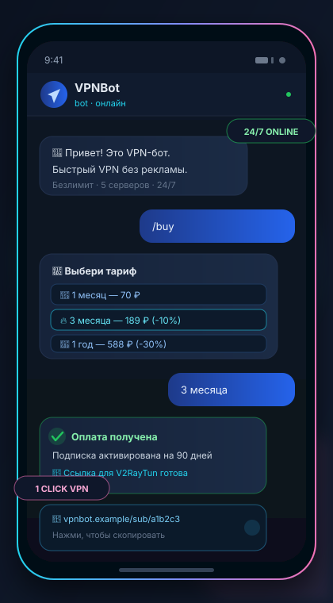
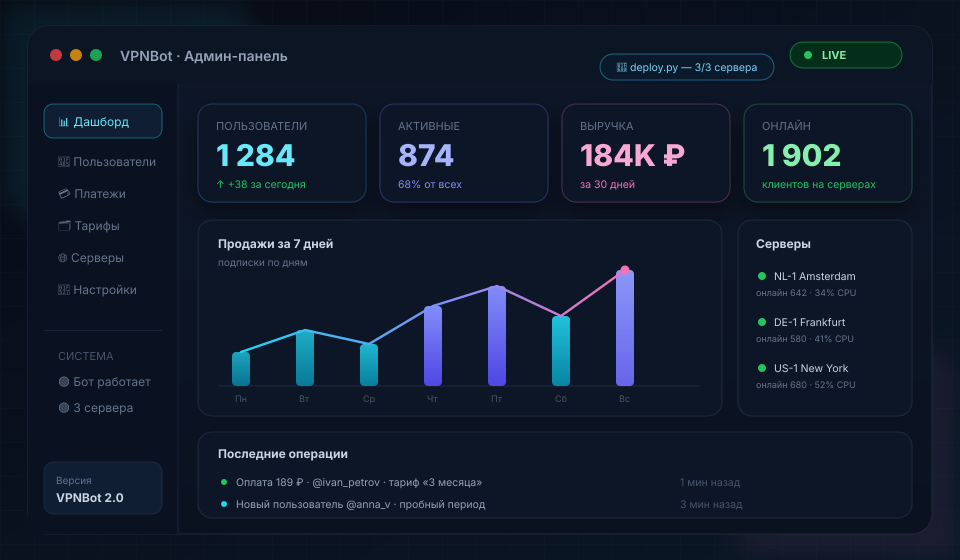
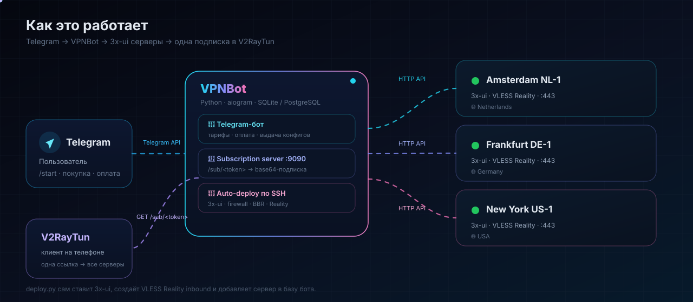

<p align="center">
  
</p>

<p align="center">
  <a href="https://www.python.org/"></a>
  <a href="https://docs.aiogram.dev/"></a>
  <a href="https://github.com/mhsanaei/3x-ui"></a>
  
  
  
</p>

<h1 align="center">VPNBot</h1>

<p align="center">
  <b>Telegram-магазин VPN-подписок с автоматическим развёртыванием 3x-ui.</b><br>
  Заполни один файл серверами — запусти одну команду — продавай подписки.
</p>

<p align="center">
  <a href="#-быстрый-старт">Быстрый старт</a> ·
  <a href="#-как-это-работает">Как это работает</a> ·
  <a href="#-тарифы-и-оплата">Тарифы</a> ·
  <a href="#-админ-панель">Админ-панель</a> ·
  <a href="#-решение-проблем">Помощь</a> ·
  <a href="SETUP_GUIDE.md">Полный гайд</a>
</p>

---

## ✨ Что это такое

**VPNBot** — готовый бизнес в одном репозитории. Бот принимает оплату, создаёт VPN-клиента на **всех** ваших серверах и отдаёт пользователю **одну ссылку-подписку** для V2RayTun / v2rayNG / Streisand / Hiddify.

Вам не нужно вручную ставить панели, создавать inbound'ы и копировать ключи. Всё делает `deploy.py`:

- 🔌 подключается к каждому VPS по SSH;
- 🧱 настраивает firewall и ускоряет сеть (BBR);
- 📦 устанавливает **3x-ui**;
- 🛡 создаёт **VLESS Reality** inbound с ключами X25519;
- 🗄 добавляет сервер в базу бота;
- 🤖 запускает Telegram-бота и подписочный сервер.

> **Один файл с серверами. Одна команда. Готово к продажам.**

---

## 🚀 Быстрый старт

### 0. Что нужно

| Компонент | Требования |
|-----------|------------|
| Машина с ботом | Windows / Linux / macOS, Python **3.11+** |
| VPN-серверы | Ubuntu **22.04 / 24.04**, root-пароль, минимум 1 шт. |
| Telegram | Токен от [@BotFather](https://t.me/BotFather) |
| Оплата | USDT TRC20 кошелёк (по умолчанию) |

### 1. Скачай проект и зависимости

```bash
git clone https://github.com/JamikKhidirov/VPNBot.git
cd VPNBot
python -m pip install -r requirements.txt
```

<details>
<summary><b>Windows: если <code>python</code> не найден</b></summary>

```powershell
py -3 -m venv .venv
.venv\Scripts\activate
pip install -r requirements.txt
```

</details>

### 2. Заполни <code>servers.json</code>

Скопируй шаблон и укажи **IP + root-пароль** каждого VPN-сервера:

```bash
copy servers.example.json servers.json      # Windows
cp servers.example.json servers.json        # Linux / macOS
```

```json
{
    "panel": {
        "username": "admin",
        "password": "",
        "port": 2053
    },
    "servers": [
        {
            "ip": "1.2.3.4",
            "password": "твой_root_пароль",
            "location": "Netherlands",
            "name": "Amsterdam NL-1",
            "ssh_port": 22,
            "vpn_port": 443
        },
        {
            "ip": "5.6.7.8",
            "password": "твой_root_пароль",
            "location": "Germany",
            "name": "Frankfurt DE-1",
            "ssh_port": 22,
            "vpn_port": 443
        }
    ]
}
```

Пароль панели можно оставить пустым — `deploy.py` **сгенерирует надёжный** и сам запишет его в `servers.json` и `.env`.

<details>
<summary><b>Ещё проще: <code>servers.txt</code> (одна строка = один сервер)</b></summary>

```text
# ip            password        location       name             ssh  vpn  panel
1.2.3.4         твой_пароль     Netherlands    Amsterdam-NL-1   22   443  2053
5.6.7.8         твой_пароль     Germany        Frankfurt-DE-1   22   443  2053
```

Можно смешивать: `servers.txt` дополняет и переопределяет `servers.json`.

</details>

### 3. Запусти всё одной командой

```bash
python deploy.py
```

Скрипт спросит **BOT_TOKEN** и **ADMIN_IDS**, развернёт серверы, создаст базу и запустит бота.

```text
✓ Создан .env из .env.example
BOT_TOKEN (от @BotFather): 123456:ABC...
ADMIN_IDS (твой Telegram ID): 123456789
✓ .env обновлён
→ Инициализация БД и тарифов...
✓ БД готова
→ Развёртывание 2 сервер(ов)...
  [1/2] Amsterdam NL-1: SSH → 3x-ui → inbound...
  [1/2] Amsterdam NL-1: ✅ 3x-ui + inbound + БД (server #1)
  [2/2] Frankfurt DE-1: SSH → 3x-ui → inbound...
  [2/2] Frankfurt DE-1: ✅ 3x-ui + inbound + БД (server #2)
→ Запуск Telegram-бота...
```

**Всё. Открывай Telegram → `/start` → покупай подписку → продавай.**

### Полезные режимы

```bash
python deploy.py --no-run        # установить всё, но не запускать бота
python deploy.py --check         # проверить SSH-доступность серверов
python deploy.py --sync          # импортировать уже готовые 3x-ui в БД
python deploy.py --init-env      # только создать/дополнить .env
python deploy.py --deploy        # только развернуть серверы
```

> ⚠️ `servers.json`, `servers.txt` и `.env` уже в `.gitignore`. Пароли и токены **не попадут** в Git.

---

## 🖼 Как это выглядит

<table>
<tr>
<td width="46%" align="center" valign="top">
  <br>
  <b>Сторона пользователя</b><br>
  <sub>Тариф → оплата → одна ссылка-подписка</sub>
</td>
<td width="54%" align="center" valign="top">
  <br>
  <b>Админ-панель</b><br>
  <sub>Статистика, выручка, серверы и онлайн</sub>
</td>
</tr>
</table>

---

## 🧭 Как это работает

<p align="center">
  
</p>

```text
Пользователь → Telegram-бот → оплата
             → подписка в БД
             → клиент создаётся на ВСЕХ активных серверах через API 3x-ui
             → пользователь получает /sub/<token>

V2RayTun → GET /sub/<token> → base64-список всех серверов
         → клиент выбирает самую быструю локацию
```

---

## 💎 Возможности

<table>
<tr>
<td width="50%" valign="top">

### 👤 Для пользователя
- 🎁 пробный период на 3 дня
- 🛒 тарифы: 1 месяц / 3 месяца / 1 год
- 💳 оплата картой, USDT или Crypto Bot
- 🔗 одна ссылка на **все** серверы
- 📋 профиль и статус подписки
- 📱 совместимость с V2RayTun, v2rayNG, Hiddify, Streisand

</td>
<td width="50%" valign="top">

### 👑 Для владельца
- 🚀 автоустановка 3x-ui по SSH
- 🛡 VLESS Reality «из коробки»
- 🌍 неограниченное число серверов
- 📊 статистика, выручка, онлайн
- 🎁 выдача и продление подписок вручную
- 📢 рассылка пользователям
- 💾 бэкап базы одной командой

</td>
</tr>
</table>

---

## 💳 Тарифы и оплата

| Тариф | Дней | Цена | Выгода |
|:------|-----:|-----:|:--------|
| 🎁 Пробный | 3 | **Бесплатно** | — |
| 🌙 1 месяц | 30 | **70 ₽** | — |
| 🔥 3 месяца | 90 | **189 ₽** | −10% |
| 🚀 1 год | 365 | **588 ₽** | −30% |

Тарифы хранятся в БД и меняются через админку или команды `/add_plan`, `/edit_plan`, `/del_plan`.

### Способы оплаты

| Способ | Настройка | Комиссия |
|--------|-----------|----------|
| 🪙 **USDT TRC20** | `WALLET_ADDRESS=...` — работает сразу | сеть |
| 💳 **ЮKassa** | `YOOKASSA_SHOP_ID`, `YOOKASSA_SECRET_KEY` | по тарифу ЮKassa |
| 🤖 **Crypto Bot** | `CRYPTOBOT_TOKEN` | по тарифу Crypto Bot |

```ini
# .env — минимальная настройка оплаты
PAYMENT_PROVIDER=wallet
WALLET_ADDRESS=TWoG8...твой_кошелёк
```

Для ЮKassa или Crypto Bot достаточно сменить `PAYMENT_PROVIDER` и добавить ключи:

```ini
PAYMENT_PROVIDER=yookassa
YOOKASSA_SHOP_ID=123456
YOOKASSA_SECRET_KEY=live_...
```

> Ручное подтверждение USDT: `/pending_wallet` → `/confirm_payment <id>`.

---

## 👑 Админ-панель

Открой `/admin` в Telegram. Внутри:

- 📊 статистика и выручка
- 👥 пользователи и их подписки
- 💳 платежи и подтверждение оплат
- 🗂 тарифы
- 🌐 VPN-серверы 3x-ui
- 🟢 кто сейчас онлайн
- 📈 нагрузка и трафик
- 🎁 выдача VPN без оплаты
- 📢 рассылка

<details>
<summary><b>Все команды администратора</b></summary>

| Команда | Что делает |
|---------|-----------|
| `/admin` | Открыть админ-панель |
| `/stats` | Статистика бота |
| `/find <id>` | Найти пользователя |
| `/give <telegram_id>` | Выдать подписку вручную |
| `/extend <telegram_id> <дни>` | Продлить подписку |
| `/configs` | Все активные конфиги |
| `/user_configs <id>` | Конфиги пользователя |
| `/ban <id>` / `/unban <id>` | Блокировка / разблокировка |
| `/payments` | Все платежи |
| `/pending_payments` | Ожидающие платежи |
| `/pending_wallet` | Ожидающие USDT-оплаты |
| `/confirm_payment <id>` | Подтвердить оплату |
| `/retry_payment <id>` | Повторить активацию |
| `/online` | Онлайн на всех серверах |
| `/server_load` | Нагрузка серверов |
| `/traffic` | Трафик по серверам |
| `/server <id>` | Детали сервера |
| `/server_toggle <id>` | Вкл/выкл сервер |
| `/server_del <id>` | Удалить сервер |
| `/check_server <id>` | Проверить 3x-ui |
| `/deploy_vps <ip>` | Установить 3x-ui на VPS |
| `/deploy_all` | Развернуть все серверы из файла |
| `/sync_servers` | Импортировать 3x-ui в БД |
| `/add_plan` | Добавить тариф |
| `/edit_plan <id> <поле> <значение>` | Изменить тариф |
| `/del_plan <id>` | Удалить тариф |
| `/backup` | Бэкап базы данных |
| `/admin_help` | Справка по командам |

</details>

---

## 🗂 Структура проекта

```text
VPNBot/
├── deploy.py                  # ⚡ одна команда: установка + запуск
├── servers.example.json       # шаблон серверов (копируется в servers.json)
├── servers.txt.example        # простой формат: ip password ...
├── .env.example               # шаблон конфигурации
├── docker-compose.yml         # запуск в Docker
├── setup-vps.sh               # установка бота на VPS
├── setup-3xui.sh              # ручная установка панели (опционально)
├── docs/assets/               # анимированные SVG для README
├── app/
│   ├── main.py                # точка входа
│   ├── bot.py                 # aiogram
│   ├── config.py              # конфигурация
│   ├── handlers/              # start, profile, payment, admin
│   ├── services/              # v2ray, vps_deploy, payment, subscription
│   ├── database/              # SQLAlchemy + SQLite/PostgreSQL
│   └── web/                   # подписочный сервер :9090
└── tests/                     # pytest
```

---

## 🧰 Технологии

| Слой | Технология |
|------|------------|
| Бот | Python 3.11+, aiogram 3 |
| База | SQLite (по умолчанию) / PostgreSQL |
| VPN | 3x-ui, Xray, VLESS Reality, XTLS Vision |
| Развёртывание | asyncssh, bash, systemd, UFW, BBR |
| Подписки | aiohttp, base64 subscription |
| Оплата | ЮKassa, Crypto Bot, USDT TRC20 |
| Деплой | Docker / Docker Compose |

---

## 🔐 Безопасность

- `.env`, `servers.json`, `servers.txt`, `vpnbot.db` — **в `.gitignore`**.
- Пароль панели 3x-ui генерируется автоматически (24 символа) и хранится только у вас.
- Firewall на каждом VPN-сервере настраивается автоматически.
- Пароли root передаются только по SSH; после установки рекомендуется сменить их и настроить SSH-ключи.
- Панель 3x-ui слушает порт **2053**. Если она не нужна снаружи — закройте порт:

```bash
ufw delete allow 2053/tcp
# или разреши только свой IP:
ufw allow from ТВОЙ_IP to any port 2053 proto tcp
```

- Для публичного бота желательно поставить домен и HTTPS (см. [SETUP_GUIDE.md](SETUP_GUIDE.md)).

---

## 🐳 Запуск в Docker

```bash
cp .env.example .env
docker compose up -d --build
docker compose logs -f bot
```

Подписки доступны на `http://IP:9090/sub/<token>`.

Опционально PostgreSQL и Redis:

```bash
docker compose --profile postgres --profile redis up -d
```

---

## 🧪 Тесты

```bash
python -m pytest tests/ -q
```

```text
33 passed
```

---

## 🩺 Решение проблем

| Проблема | Что делать |
|----------|-----------|
| `asyncssh не установлен` | `pip install -r requirements.txt` |
| SSH: `Permission denied` | Проверь root-пароль и порт `ssh_port` |
| 3x-ui не отвечает | `python deploy.py --check`, затем `ufw status` на сервере |
| Не создаётся inbound | Проверь `/var/log/x-ui/x-ui.log` и версию 3x-ui |
| Нет ссылки подписки | Проверь `SUB_DOMAIN`, порт `9090` и firewall |
| Бот не стартует | Проверь `BOT_TOKEN`, `ADMIN_IDS`, запусти `python deploy.py --init-env` |
| Платёж прошёл, подписка нет | `/retry_payment <id>` |
| Нужно переимпортировать сервер | `python deploy.py --sync` или `/sync_servers` |

Больше деталей — в [SETUP_GUIDE.md](SETUP_GUIDE.md).

---

## ❤️ Поддержка

Если проект помог — поставь ⭐ репозиторию. Это лучший способ сказать спасибо.

<p align="center">
  <a href="https://github.com/JamikKhidirov/VPNBot">
    
  </a>
</p>
